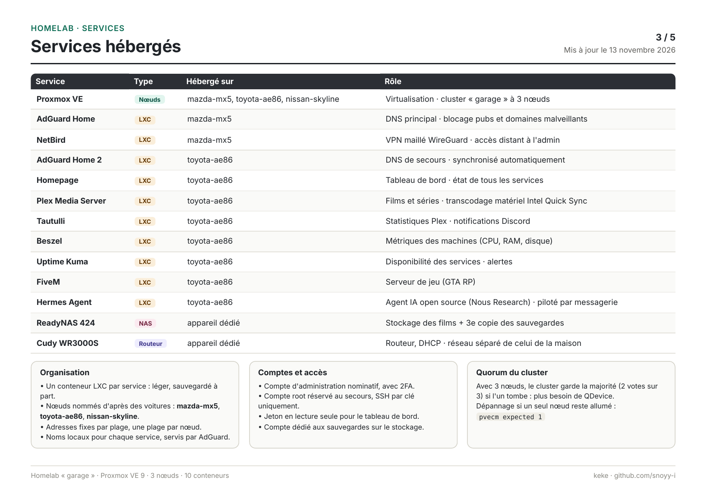
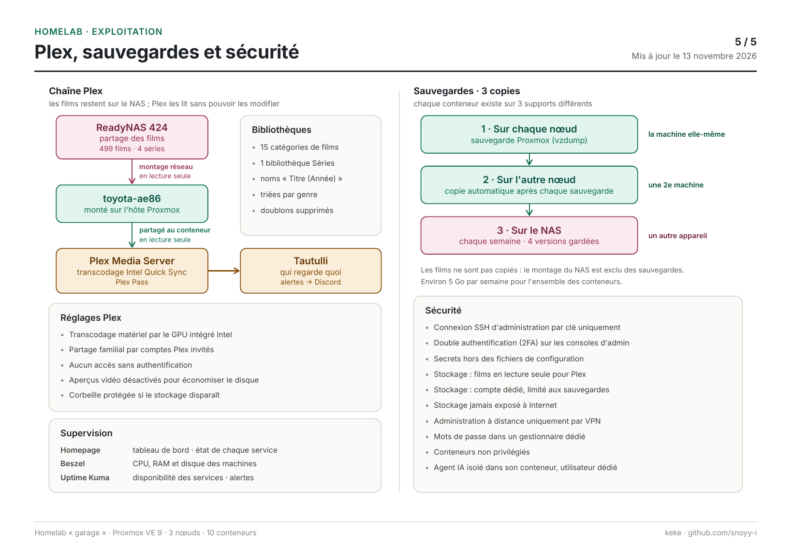

# Mon homelab

Salut, moi c'est keke, je suis en BTS SIO option SISR. Ici je partage le homelab que je monte chez moi pour apprendre.

## Comment ça a commencé

En juin 2026, j'ai arrêté mes études dans la clim, le froid et le conditionnement d'air parce que ça ne me plaisait pas. Je venais de valider ma première année de BTS. Je me suis demandé ce qui m'avait toujours passionné, et c'était l'informatique. Un ami m'a conseillé le BTS SIO option SISR, et une semaine après j'étais inscrit chez Ensitech à Cergy.

Pour prendre de l'avance, et toujours sur les conseils de ce même ami, j'ai décidé de monter mon propre homelab.

## Mon matériel

J'ai commencé avec un Raspberry Pi 5 (8 Go de RAM). J'ai installé Proxmox VE dessus pour découvrir, c'était ma première vraie expérience et ça s'est super bien passé.

Ensuite j'ai acheté mon premier vrai PC pour le homelab, un HP ProDesk Mini, et j'ai récupéré un vieux portable Lenovo qui traînait chez moi. Les deux sont sous Proxmox et forment un cluster que j'ai appelé "garage". J'ai donné des noms de voitures à mes machines 😊

- **toyota-ae86** (HP ProDesk Mini) : c'est là que tournent la plupart de mes services
- **mazda-mx5** (le vieux portable Lenovo) : mon nœud "critique", il fait tourner le DNS et l'accès à distance
- un **ReadyNAS** pour stocker mes films et mes sauvegardes
- un routeur **Cudy** pour mettre le homelab sur un réseau séparé de celui de la maison
- le **Raspberry Pi 5**, qui va bientôt servir de 3e vote pour le cluster

Tout est rangé dans un petit rack 10 pouces que j'ai imprimé en 3D.

## Mes services

Chaque service tourne dans son propre conteneur LXC.

- **AdGuard Home** (x2) : mon DNS, il bloque les pubs sur tout le réseau. J'en ai mis un sur chaque machine, comme ça si une tombe, internet marche toujours
- **NetBird** : un VPN pour accéder à mon homelab quand je ne suis pas chez moi
- **Plex** : mes films et mes séries, pour moi et mes proches
- **Tautulli** : pour voir qui regarde quoi sur Plex, avec des alertes sur Discord
- **Beszel** et **Uptime Kuma** : pour surveiller mes machines et savoir quand un service ne répond plus
- **Homepage** : une page d'accueil avec tous mes services
- **FiveM** : un serveur GTA RP (éteint pour l'instant)

## Mes sauvegardes

J'ai appris qu'une sauvegarde à un seul endroit, ça ne suffit pas. Donc chaque conteneur est sauvegardé 3 fois :

1. sur la machine elle-même
2. sur l'autre machine du cluster
3. sur le NAS, une fois par semaine

## Ce que j'ai appris (et mes galères)

- En YAML, un espace en trop et plus rien ne marche. Homepage me l'a bien fait comprendre
- Avec un cluster de 2 machines, si une s'éteint, l'autre se bloque (le quorum). C'est pour ça que je veux ajouter le Raspberry Pi comme 3e vote
- Une erreur bizarre ça peut juste être une ligne oubliée dans un fichier de config
- Les mots de passe ne vont jamais dans les fichiers de config ni sur les captures d'écran, ils vont dans un gestionnaire de mots de passe
- Je n'ouvre pas mon interface d'admin sur internet, j'y accède seulement par le VPN

## Les schémas

Voici les schémas de mon infra (sans les IP bien sûr).

Le PDF complet est ici : [homelab-garage.pdf](homelab-garage.pdf)

## La suite

- [ ] acheter un switch 8 ports pour faire des VLAN
- [ ] mettre le Raspberry Pi en QDevice
- [ ] acheter un onduleur
- [ ] tester une vraie restauration de sauvegarde
